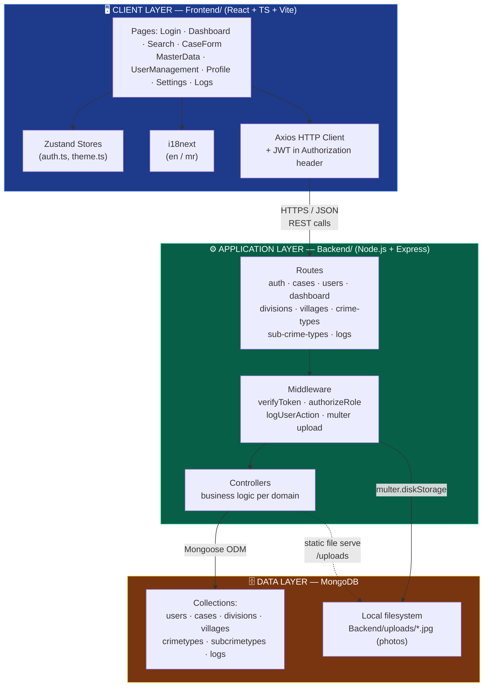
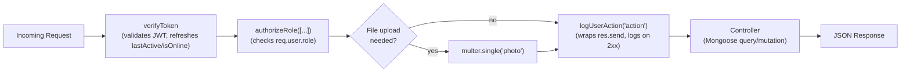
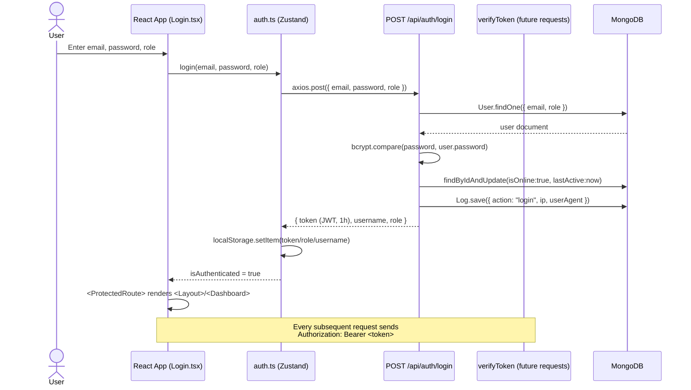
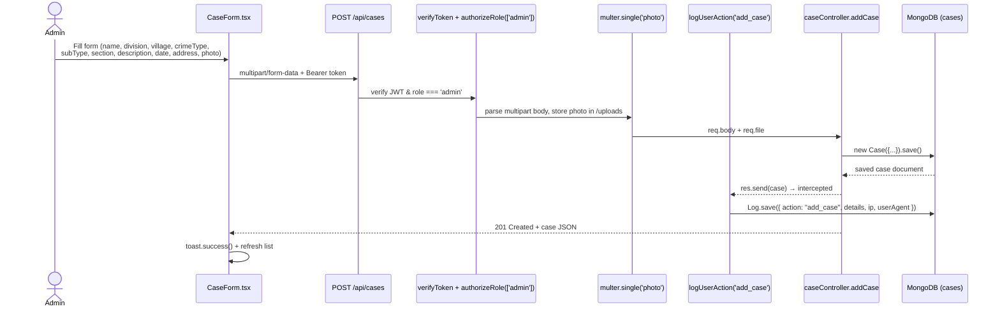
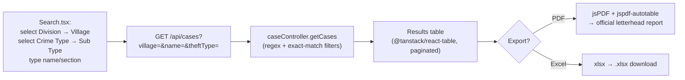
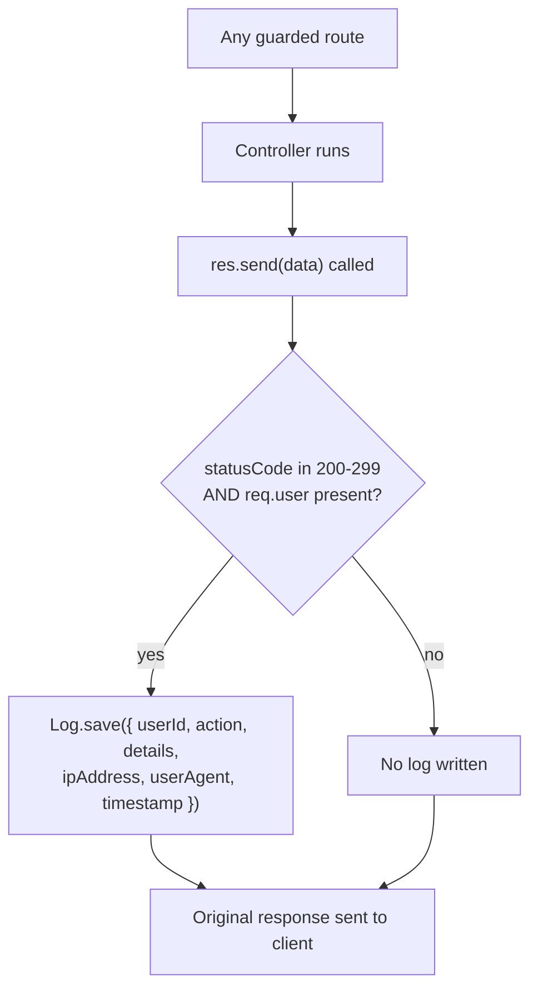
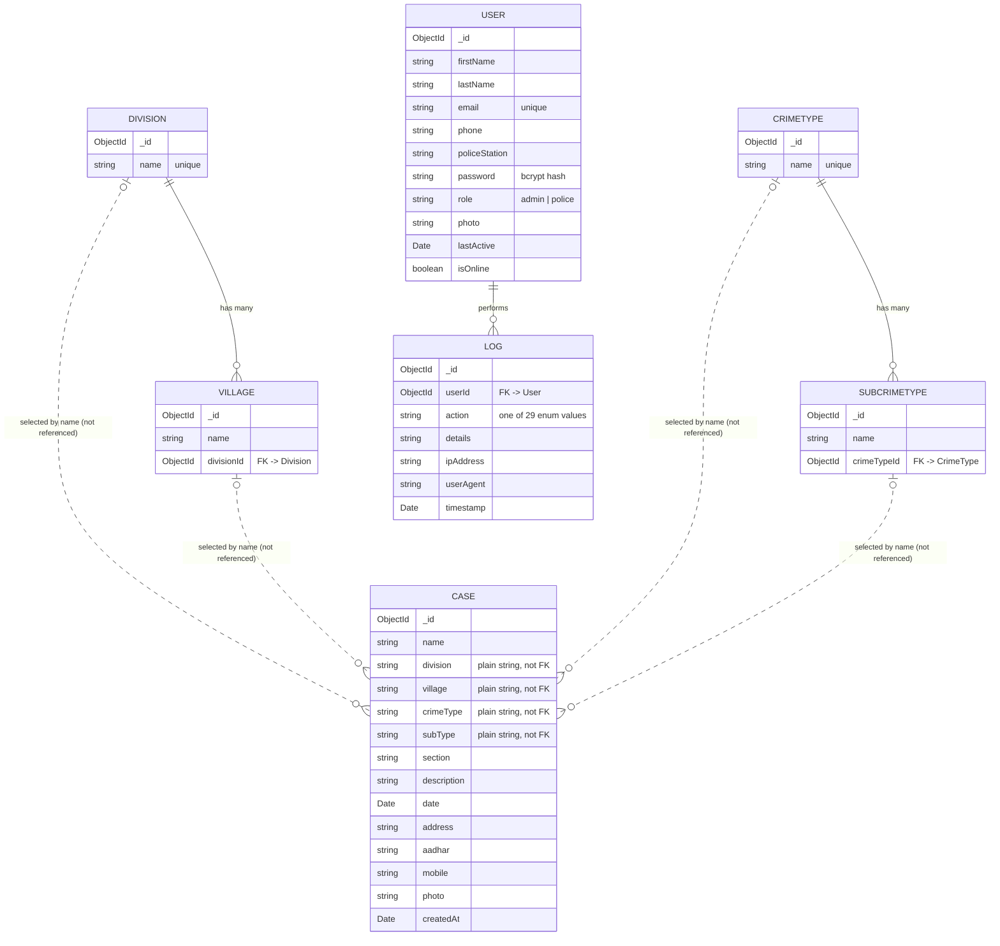

# 🚔 e-MOB — e-Modus Operandi Bureau

### Digital Case & Accused Records Management System for Maharashtra Police — Local Crime Branch

<div align="center">


**A full-stack MERN application that digitizes the registration, search, and reporting of accused records across Police Divisions and Stations — with role-based access, bilingual UI, full audit logging, and official PDF/Excel reporting.**

[](#-license)
[](https://nodejs.org/)
[](https://expressjs.com/)
[](https://react.dev/)
[](https://www.typescriptlang.org/)
[](https://www.mongodb.com/)
[](https://vitejs.dev/)
[](https://tailwindcss.com/)

[Features](#-feature-highlights) · [Architecture](#-system-architecture) · [Tech Stack](#-technology-stack) · [Workflows](#-core-workflows) · [API](#-api-reference) · [Getting Started](#-getting-started)

</div>

---

## 📋 Table of Contents

1. [Overview](#-overview)
2. [Feature Highlights](#-feature-highlights)
3. [Technology Stack](#-technology-stack)
4. [System Architecture](#-system-architecture)
5. [Repository Structure](#-repository-structure)
6. [Core Workflows](#-core-workflows)
7. [Data Model / ER Diagram](#-data-model--er-diagram)
8. [Role-Based Access Control](#-role-based-access-control)
9. [Getting Started](#-getting-started)
10. [Environment Variables](#-environment-variables)
11. [NPM Scripts Reference](#-npm-scripts-reference)
12. [API Reference](#-api-reference)
13. [Internationalization](#-internationalization)
14. [Security Model](#-security-model)
15. [Known Limitations & Technical Notes](#-known-limitations--technical-notes)
16. [Troubleshooting](#-troubleshooting)
17. [Roadmap](#-roadmap)
18. [Contributing](#-contributing)
19. [License](#-license)
20. [Contact](#-contact)

---

## 🌟 Overview

**e-MOB** replaces the manual, paper-based register historically used by the **Local Crime Branch, Chhatrapati Sambhajinagar Rural** to track accused persons across Divisions and Police Stations. It gives every station a shared, searchable, auditable database with:

- A **single source of truth** for accused/case records across all Divisions and Police Stations.
- **Instant search** across name, section, crime type, and station — instead of flipping through physical registers.
- **Statistical dashboards** for leadership to see crime trends by station and crime type at a glance.
- **Full accountability** — every view, create, edit, and delete is written to an immutable audit log with user, IP, and timestamp.
- **Bilingual UI** (English / Marathi) so every station can use it in the language its staff is comfortable with.
- **One-click official reporting** — PDF exports formatted like the department's official letterhead, plus raw Excel exports for analysis.

| | |
|---|---|
| **Domain** | Law-enforcement records management |
| **Architecture** | Three-tier MERN (React SPA ↔ REST API ↔ MongoDB) |
| **Primary users** | LCB Admin (full access), Police Station users (read/search/report) |
| **Deployment shape** | Two independently deployable apps: `Backend/` (API) and `Frontend/` (static SPA) |

---

## ✨ Feature Highlights

### 🔐 Authentication & Authorization
- JWT-based login (`email` + `password` + `role`), 1-hour token expiry.
- Passwords hashed with **bcrypt** (10 salt rounds) — never stored in plaintext.
- `verifyToken` + `authorizeRole([...])` middleware guard every sensitive route.
- Frontend route guard (`ProtectedRoute`) redirects unauthenticated users to `/login`; session is restored from a decoded JWT in `localStorage` on page load.
- Live "online" presence — every authenticated request refreshes `lastActive` / `isOnline` on the user document, powering the **Live Users** admin widget.

### 📁 Accused / Case Records
- Full CRUD on case records: name, division, police station, crime type, sub-crime type, section, incident date, address, Aadhar, mobile, description, and photo.
- Cascading selects: **Division → Police Station** and **Crime Type → Sub-Crime Type**.
- Photo upload via **Multer** (disk storage, timestamp-based filenames).
- Server-side filtering by village, name (regex, case-insensitive), and crime type.
- Admin-only create / edit / delete; Police role has read + search + export.

### 📊 Dashboard & Analytics
- Real-time counts: total cases, total police stations, total divisions.
- Aggregation pipelines for **cases-by-police-station** and **cases-by-crime-type**.
- Admin-only **live users** panel (anyone active in the last 5 minutes).

### 🗂️ Master Data Management
Four reference-data modules that drive every dropdown in the app:
- **Divisions** — top-level organizational units.
- **Villages (Police Stations)** — linked to a Division via `divisionId`.
- **Crime Types** — top-level offence categories.
- **Sub Crime Types** — linked to a Crime Type via `crimeTypeId`.

### 📝 Audit Logging
- A `logUserAction(action)` middleware wraps `res.send` to write a `Log` document **only after a successful (2xx) response** — failed requests are never logged as successes.
- Captures: user id, action, human-readable detail string, IP address (`x-forwarded-for` → `req.ip` → socket), user agent, timestamp.
- 29 distinct tracked actions covering auth, cases, users, and every master-data entity.
- Admin-only **Logs** screen: paginated, filterable by action/date/user, plus aggregated action counts, per-user activity, and daily activity trends.

### 🌐 Internationalization
- `i18next` + `react-i18next` + browser language auto-detection.
- Full **English** and **Marathi** (`en.json` / `mr.json`) translation sets.
- Instant language switch via `LanguageSwitcher` with no reload.

### 🎨 UI / UX
- Tailwind CSS, dark-mode toggle persisted via a Zustand store, responsive layout with collapsible sidebar.
- Toast notifications (`react-hot-toast`), modal dialogs, image previews, sortable tables (`@tanstack/react-table`), client-side pagination.
- **Official PDF generation** (`jspdf` + `jspdf-autotable` + `html2pdf.js`) styled after the department's letterhead template.
- **Excel export** (`xlsx`) of filtered result sets for offline analysis.

---

## 🛠️ Technology Stack

### Frontend — `Frontend/` (React SPA)

| Technology | Version | Purpose |
|---|---|---|
| **React** | 18.3.1 | UI framework |
| **TypeScript** | 5.5.3 | Static typing |
| **Vite** | 5.4.2 | Dev server & bundler |
| **React Router DOM** | 6.29.0 | Client-side routing (`HashRouter`) |
| **Tailwind CSS** | 3.4.1 | Utility-first styling |
| **Zustand** | 4.5.2 | Lightweight global state (auth, theme) |
| **Axios** | 1.8.1 | HTTP client |
| **@tanstack/react-table** | 8.13.2 | Data-grid logic (sort/filter/paginate) |
| **react-i18next / i18next** | 14.0.5 / 23.10.0 | Internationalization (English/Marathi) |
| **jsPDF + jsPDF-AutoTable** | 2.5.1 / 3.8.2 | Official PDF report generation |
| **html2pdf.js** | 0.10.3 | HTML → PDF conversion |
| **xlsx** | 0.18.5 | Excel export |
| **react-hot-toast** | 2.4.1 | Toast notifications |
| **jwt-decode** | 4.0.0 | Client-side JWT parsing / expiry check |
| **date-fns** | 3.3.1 | Date formatting |
| **lucide-react** | 0.344.0 | Icon set |
| **clsx / tailwind-merge** | 2.1.0 / 2.2.1 | Conditional/merged class names |

### Backend — `Backend/` (REST API)

| Technology | Version | Purpose |
|---|---|---|
| **Node.js** | 16+ | Runtime |
| **Express** | 4.21.2 | HTTP framework & routing |
| **MongoDB** | — | Primary datastore |
| **Mongoose** | 8.10.1 | Schema modeling / ODM |
| **jsonwebtoken** | 9.0.2 | JWT issuing & verification |
| **bcrypt** | 5.1.1 | Password hashing |
| **multer** | 1.4.5-lts.1 | Multipart photo uploads |
| **express-validator** | 7.2.1 | Request input validation |
| **cors** | 2.8.5 | Cross-origin access control |
| **dotenv** | 16.4.7 | Environment variable loading |
| **pm2** | 6.0.5 | Production process management |
| **nodemon** (dev) | 3.1.9 | Hot-reload during development |

### Tooling
- **ESLint 9** + `typescript-eslint` + `eslint-plugin-react-hooks` — linting.
- **PostCSS** + **Autoprefixer** — CSS pipeline for Tailwind.
- **Git** — version control (this repository).

---

## 🏗️ System Architecture

e-MOB is a classic **three-tier** application: a React single-page app talks to a stateless Express REST API over HTTPS/JSON, and the API is the only thing that talks to MongoDB.



### Backend layering (routes → middleware → controller → model)

Every protected route in `Backend/routes/*.js` is composed as a middleware chain before it ever reaches business logic:



---

## 📂 Repository Structure

```
MOB-Application/
├── Backend/                       # Express REST API
│   ├── controllers/               # Business logic (one file per domain)
│   │   ├── authController.js      # login / logout
│   │   ├── caseController.js      # accused/case CRUD
│   │   ├── userController.js      # user CRUD + profile
│   │   ├── dashboardController.js # stats + live users
│   │   ├── divisionController.js
│   │   ├── villageController.js
│   │   ├── crimeTypeController.js
│   │   ├── subCrimeTypeController.js
│   │   └── logController.js       # audit log CRUD + stats
│   ├── middleware/
│   │   ├── auth.js                # verifyToken, authorizeRole
│   │   ├── logMiddleware.js       # logUserAction (audit trail)
│   │   └── uploadMiddleware.js    # multer disk storage config
│   ├── models/                    # Mongoose schemas
│   │   ├── User.js · Case.js · Division.js
│   │   ├── Village.js · CrimeType.js · SubCrimeType.js
│   │   └── Log.js
│   ├── routes/                    # Express routers, one per resource
│   ├── uploads/                   # Uploaded accused/user photos (disk storage)
│   ├── createAdmin.js             # One-off script: seeds a first admin user
│   ├── seed.js                    # Database seed script
│   ├── server.js                  # App entry point — Express app + route mounting
│   └── package.json
│
├── Frontend/                      # React + TypeScript SPA
│   ├── src/
│   │   ├── pages/                 # Login, Dashboard, Search, CaseForm,
│   │   │                          # MasterData, UserManagement, Profile, Settings, Logs
│   │   ├── components/            # Header, Sidebar, Layout, LanguageSwitcher
│   │   ├── store/                 # Zustand stores: auth.ts, theme.ts
│   │   ├── i18n/                  # i18next config + locales/{en,mr}.json
│   │   ├── lib/                   # Shared utilities (clsx/tailwind-merge helpers)
│   │   ├── data/                  # Sample/fixture data
│   │   └── App.tsx                # Route definitions (HashRouter)
│   ├── public/                    # Static assets + official report templates
│   ├── vite.config.ts
│   ├── tailwind.config.js
│   └── package.json
│
├── mob.*.json                     # MongoDB collection exports (cases, users, divisions,
│                                   # villages, crimetypes, subcrimetypes, logs) — data snapshots
├── template.docx / .htm / .mht     # Official letterhead templates used as the basis
│   / template_files/              # for generated PDF reports
└── README.md
```

> **Two independent apps, one repo.** There is no root-level `package.json` or monorepo tooling (no Lerna/Nx/Turborepo/workspaces) — `Backend/` and `Frontend/` are installed, run, and deployed separately.

---

## 🔄 Core Workflows

### 1. Login & Session Flow



### 2. Creating a New Accused Record (Admin only)



### 3. Search → Export Workflow



### 4. Audit Logging (cross-cutting)

Every mutating or sensitive `GET` route is wrapped with `logUserAction('<action>')`. The middleware monkey-patches `res.send` so the audit entry is written **after** the controller succeeds (HTTP 2xx) — a failed request never produces a false "success" log line.



---

## 🧬 Data Model / ER Diagram



---

## 👤 Role-Based Access Control

| Capability | Admin (LCB Admin) | Police (Station User) |
|---|:---:|:---:|
| View / search cases | ✅ | ✅ |
| Export PDF / Excel | ✅ | ✅ |
| Add / edit / delete cases | ✅ | ❌ |
| View dashboard stats | ✅ | ✅ |
| View live users widget | ✅ | ❌ |
| Manage users (CRUD) | ✅ | ❌ |
| Manage master data (divisions/villages/crime types/sub-types) | ✅ | ❌ |
| View audit logs & log statistics | ✅ | ❌ |
| Manage own profile / password / photo | ✅ | ✅ |

Enforced server-side via `authorizeRole(['admin'])` / `authorizeRole(['admin','police'])` on every route, and mirrored client-side by conditionally rendering admin-only UI.

---

## 🚀 Getting Started

### Prerequisites

| Requirement | Version | Notes |
|---|---|---|
| [Node.js](https://nodejs.org/) | 16+ | Runtime for both apps |
| [MongoDB](https://www.mongodb.com/try/download/community) | 5+ | Local instance or MongoDB Atlas |
| npm | bundled with Node | Package manager used in this repo |
| Git | any | Version control |

### 1. Clone & install

```bash
git clone https://github.com/Shantanu-Kulkarni1229/MOB-Application.git
cd MOB-Application
```

### 2. Backend setup

```bash
cd Backend
npm install
```

Create `Backend/.env`:

```env
MONGO_URI=mongodb://localhost:27017/mob
PORT=5000
JWT_SECRET=change-this-to-a-long-random-string
```

Run it:

```bash
npm run dev      # nodemon, hot reload (development)
# or
npm start        # node server.js (production-style)
```

Verify: `GET http://localhost:5000/` → `"API is running..."`

### 3. Seed the first admin user

The repo ships two helper scripts — **edit them first to use your own email/password**, then run once:

```bash
node createAdmin.js   # creates a single admin user directly via the User model
# or
npm run seed          # runs seed.js
```

> ⚠️ Never commit real credentials to `createAdmin.js` / `seed.js`. Treat them as local-only bootstrap scripts.

### 4. Frontend setup

```bash
cd Frontend
npm install
```

Create `Frontend/.env`:

```env
VITE_BACKEND_URL=http://localhost:5000
```

Run it:

```bash
npm run dev        # Vite dev server, default http://localhost:5173
npm run build      # production build -> Frontend/dist
npm run preview    # preview the production build locally
npm run lint        # ESLint
```

Open `http://localhost:5173`, log in with the admin account you just created, and start adding Divisions → Villages → Crime Types → Sub Crime Types (master data) before creating your first case.

> **Routing note:** the SPA uses `HashRouter` (URLs look like `/#/dashboard`), so it can be served from any static host without server-side rewrite rules.

---

## 🔧 Environment Variables

### Backend (`Backend/.env`)

| Variable | Required | Description |
|---|---|---|
| `MONGO_URI` | ✅ | MongoDB connection string (local or Atlas) |
| `PORT` | ✅ | Port the Express server listens on (defaults to `5000`) |
| `JWT_SECRET` | ✅ | Secret used to sign/verify JWTs — use a long random string in production |

### Frontend (`Frontend/.env`)

| Variable | Required | Description |
|---|---|---|
| `VITE_BACKEND_URL` | ✅ | Base URL of the API the SPA talks to (e.g. `http://localhost:5000`) |

---

## 📜 NPM Scripts Reference

### `Backend/package.json`

| Script | Command | Use |
|---|---|---|
| `npm start` | `node server.js` | Run the API without hot-reload |
| `npm run dev` | `nodemon server.js` | Development with auto-restart |
| `npm run seed` | `node seed.js` | Seed/reset reference + sample data |

### `Frontend/package.json`

| Script | Command | Use |
|---|---|---|
| `npm run dev` | `vite` | Local dev server with HMR |
| `npm run build` | `vite build` | Production build to `dist/` |
| `npm run preview` | `vite preview` | Serve the production build locally |
| `npm run lint` | `eslint .` | Lint the codebase |

---

## 📡 API Reference

Base URL: `http://localhost:5000/api` · All protected routes require `Authorization: Bearer <token>`.

### Auth — `/api/auth`
| Method | Endpoint | Access | Description |
|---|---|---|---|
| `POST` | `/login` | Public | Body: `{ email, password, role }` → `{ token, username, role }` |
| `POST` | `/logout` | Authenticated | Marks user offline, writes a `logout` audit entry |

### Cases — `/api/cases`
| Method | Endpoint | Access | Description |
|---|---|---|---|
| `GET` | `/` | admin, police | Query: `village`, `name` (regex), `theftType` |
| `POST` | `/` | admin | `multipart/form-data` incl. `photo`; creates a case |
| `PUT` | `/:id` | admin | Update a case; `photo` optional |
| `DELETE` | `/:id` | admin | Delete a case |

### Users — `/api/users`
| Method | Endpoint | Access | Description |
|---|---|---|---|
| `GET` | `/profile` | Authenticated | Current user's profile |
| `PUT` | `/profile` | Authenticated | Update current user's profile |
| `GET` | `/` | admin | List all users |
| `POST` | `/` | admin | Create a user (`multipart/form-data`, optional `photo`) |
| `PUT` | `/:id` | admin | Update a user |
| `DELETE` | `/:id` | admin | Delete a user |

### Dashboard — `/api/dashboard`
| Method | Endpoint | Access | Description |
|---|---|---|---|
| `GET` | `/stats` | admin, police | `{ totalCases, casesByVillage[], casesByTheftType[], totalPoliceStation, totalDivisions }` |
| `GET` | `/live-users` | admin | Users active in the last 5 minutes |

### Master data — Divisions, Villages, Crime Types, Sub-Crime Types
| Method | Endpoint | Access | Description |
|---|---|---|---|
| `GET` | `/api/divisions` | admin, police | List divisions |
| `POST` / `PUT /:id` / `DELETE /:id` | `/api/divisions` | admin | Manage divisions |
| `GET` | `/api/villages` | admin, police | List villages |
| `GET` | `/api/villages/by-division/:divisionId` | admin, police | Villages for a division |
| `POST` / `PUT /:id` / `DELETE /:id` | `/api/villages` | admin | Manage villages |
| `GET` | `/api/crime-types` | admin, police | List crime types |
| `POST` / `PUT /:id` / `DELETE /:id` | `/api/crime-types` | admin | Manage crime types |
| `GET` | `/api/sub-crime-types` | admin, police | List sub-crime types |
| `GET` | `/api/sub-crime-types/by-crime-type/:crimeTypeId` | admin, police | Sub-types for a crime type |
| `POST` / `PUT /:id` / `DELETE /:id` | `/api/sub-crime-types` | admin | Manage sub-crime types |

### Logs — `/api/logs`
| Method | Endpoint | Access | Description |
|---|---|---|---|
| `GET` | `/` | admin | Paginated logs, filterable by action/date/user |
| `GET` | `/stats` | admin | Action counts, top-user activity, daily activity trend |
| `POST` | `/` | Authenticated | Manually create a log entry |
| `DELETE` | `/` | admin | Purge logs older than a given date |

### Static files
`GET /uploads/:filename` — serves uploaded photos directly (`express.static("uploads")`).

### Error shape
```json
{ "message": "Error description", "error": "Detailed error (dev only)" }
```
| Code | Meaning |
|---|---|
| `200/201` | Success / Created |
| `400` | Bad request |
| `401` | Missing/invalid token |
| `403` | Authenticated but not authorized for this role |
| `404` | Not found |
| `500` | Server error |

---

## 🌐 Internationalization

- Powered by `i18next`, `react-i18next`, and `i18next-browser-languagedetector`.
- Translation files: `Frontend/src/i18n/locales/en.json` and `mr.json`.
- Language auto-detected from the browser, switchable at runtime via the `LanguageSwitcher` component — no page reload required.

---

## 🔒 Security Model

- **Passwords** — hashed with bcrypt (cost factor 10) in a Mongoose `pre('save')` hook; raw passwords are never persisted.
- **Authentication** — stateless JWTs (1h expiry), verified on every protected request by `verifyToken`.
- **Authorization** — `authorizeRole([...])` enforces per-route role checks (admin vs. police) on the server — the real trust boundary; frontend route guards are UX, not security.
- **File uploads** — handled by Multer with disk storage and timestamp-based filenames to avoid collisions/overwrites.
- **CORS** — enabled via the `cors` middleware for cross-origin API access.
- **Audit trail** — every sensitive action is logged with actor, IP, user agent, and timestamp (see [Core Workflows → Audit Logging](#4-audit-logging-cross-cutting)).
- **Secrets** — `MONGO_URI` / `JWT_SECRET` live in `.env` files (gitignored), never hardcoded in source.

### Production hardening checklist
- [ ] Rotate `JWT_SECRET` to a long, random value and keep it out of version control.
- [ ] Remove/rotate the credentials currently hardcoded in `createAdmin.js` before deploying.
- [ ] Serve over HTTPS; set secure cookie/CORS origins explicitly instead of the open default.
- [ ] Add request-size and file-type limits to `uploadMiddleware.js` (currently unrestricted at the Multer layer).
- [ ] Add rate limiting on `/api/auth/login`.

---

## ⚠️ Known Limitations & Technical Notes

These are observations about the current codebase worth knowing before extending it:

- **`Case` references are denormalized strings, not foreign keys.** `division`, `village`, `crimeType`, and `subType` on a `Case` are plain `String` fields (the selected label/id as sent by the frontend), *not* Mongoose `ObjectId` refs — unlike `Village.divisionId` and `SubCrimeType.crimeTypeId`, which are real refs. Renaming a Division/Village/CrimeType will **not** retroactively update existing case records.
- **`createAdmin.js` and `seed.js` contain bootstrap credentials in source.** Treat these as local-only scripts; change the email/password before running against any shared or production database.
- **File upload has no size/type enforcement at the Multer layer** (`Backend/middleware/uploadMiddleware.js`) — the "500KB, images only" rule mentioned in the UI is a client-side convention, not a server-side guarantee.
- **Root-level stray files** — `mob.*.json` are MongoDB collection export dumps, and the root `template.docx/.htm/.mht` + `template_files/` mirror the official letterhead template also present in `Frontend/public/`. These aren't part of either app's build and can be treated as reference/data snapshots rather than source.

---

## 🐛 Troubleshooting

| Symptom | Likely cause | Fix |
|---|---|---|
| `MongoServerError: connect ECONNREFUSED` | MongoDB not running / wrong `MONGO_URI` | Start MongoDB locally, or verify your Atlas URI/IP allowlist |
| `EADDRINUSE: address already in use :::5000` | Port already bound | Change `PORT` in `.env`, or kill the process holding it |
| `403 Invalid token` right after login | `JWT_SECRET` changed or token expired (1h) | Log out, clear `localStorage`, log back in |
| Frontend requests fail / CORS errors | `VITE_BACKEND_URL` wrong, backend not running | Check `.env`, confirm backend is up on the expected port |
| Uploaded photos return `404` | `uploads/` missing or static route not mounted | Confirm `app.use("/uploads", express.static("uploads"))` in `server.js` and that the file exists |
| `vite build` fails to resolve an import | Stale `node_modules` | `rm -rf node_modules package-lock.json && npm install` |

---

## 🗺️ Roadmap

- [ ] Replace string-based `Case` → master-data links with real `ObjectId` references
- [ ] Server-side file-size/type validation for uploads
- [ ] Rate limiting + account lockout on login
- [ ] Two-factor authentication for admin accounts
- [ ] Richer dashboard visualizations (charts, not just tables)
- [ ] Automated test suite (currently no tests are configured)
- [ ] CI pipeline for lint/build/test on every PR
- [ ] Dedicated deployment guide (Docker/Nginx/PM2 reference setup)

---

## 🤝 Contributing

1. Fork the repository
2. Create a feature branch: `git checkout -b feature/your-feature`
3. Commit with a clear message: `git commit -m "Add your feature"`
4. Push: `git push origin feature/your-feature`
5. Open a Pull Request describing *what* changed and *why*

Please keep PRs focused, follow the existing code style in the file you're editing, and update this README when you change architecture, routes, or environment variables.

---

## 📄 License

Licensed under the **MIT License**.

```
MIT License

Copyright (c) 2025 Maharashtra Police - Local Crime Branch

Permission is hereby granted, free of charge, to any person obtaining a copy
of this software and associated documentation files (the "Software"), to deal
in the Software without restriction, including without limitation the rights
to use, copy, modify, merge, publish, distribute, sublicense, and/or sell
copies of the Software, and to permit persons to whom the Software is
furnished to do so, subject to the following conditions:

The above copyright notice and this permission notice shall be included in all
copies or substantial portions of the Software.

THE SOFTWARE IS PROVIDED "AS IS", WITHOUT WARRANTY OF ANY KIND, EXPRESS OR
IMPLIED, INCLUDING BUT NOT LIMITED TO THE WARRANTIES OF MERCHANTABILITY,
FITNESS FOR A PARTICULAR PURPOSE AND NONINFRINGEMENT. IN NO EVENT SHALL THE
AUTHORS OR COPYRIGHT HOLDERS BE LIABLE FOR ANY CLAIM, DAMAGES OR OTHER
LIABILITY, WHETHER IN AN ACTION OF CONTRACT, TORT OR OTHERWISE, ARISING FROM,
OUT OF OR IN CONNECTION WITH THE SOFTWARE OR THE USE OR OTHER DEALINGS IN THE
SOFTWARE.
```

> No separate `LICENSE` file currently exists in this repository — add one if you need the terms above to be machine-readable by tooling (GitHub's license detector, dependency scanners, etc.).

---

## 📞 Contact

**Maharashtra Police — Local Crime Branch**
Office of the Superintendent of Police, Chhatrapati Sambhajinagar Rural
T.C.K Center Road, Tilakdi, Pin-7, Chhatrapati Sambhajinagar

📞 0240-2380978 · 🌐 [csn.mahapolice.gov.in](https://csn.mahapolice.gov.in/)

**Maintainer:** [Shantanu-Kulkarni1229](https://github.com/Shantanu-Kulkarni1229) — open an [issue](../../issues) for bugs or feature requests.

---

<div align="center">

**Built for Maharashtra Police — Local Crime Branch, Chhatrapati Sambhajinagar Rural**

⭐ Star this repository if it helped you.

[Report Bug](../../issues) · [Request Feature](../../issues)

</div>
